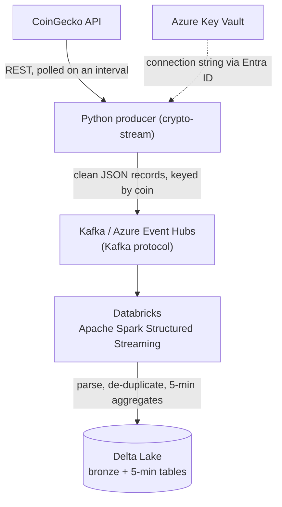

# Crypto Stream — real-time cryptocurrency data pipeline

[](https://github.com/kzurawska8/crypto-stream/actions/workflows/ci.yml)

An end-to-end **streaming data engineering** project: it ingests live crypto market
data from a public API, streams it through Kafka / Azure Event Hubs, and processes it
with Apache Spark on Databricks into a Delta Lake lakehouse - with credentials managed
in Azure Key Vault.

> Built to demonstrate a modern, cloud-native data pipeline end to end:
> **ingestion → streaming transport → distributed processing → lakehouse storage**,
> with production-style secret management.

## Architecture



## Demo

**Producer streaming into Azure Event Hubs (secret pulled from Key Vault):**


### Data landing in Azure Event Hubs

| Namespace overview | Incoming-message metrics |
| --- | --- |
|  |  |

### Processed into Delta tables on Databricks

| Notebook output (5-min aggregates) | Delta tables in the catalog |
| --- | --- |
|  |  |

## Tech stack & skills demonstrated

| Area | Technology |
|------|-----------|
| Language / tooling | Python 3.14, `uv` |
| Streaming transport | Apache Kafka (local), **Azure Event Hubs** (Kafka-compatible API) |
| Stream processing | **Apache Spark** (Structured Streaming) on **Databricks** |
| Storage / format | **Delta Lake** (lakehouse, medallion bronze → silver) |
| Secrets & identity | **Azure Key Vault**, **Microsoft Entra ID** service principal |
| Containerization | Docker, Docker Compose |
| Engineering practices | modular code, config-as-environment, retries/backoff, graceful shutdown, `.gitignore` secret hygiene, **unit tests + CI** |

## What it does

1. Polls the free CoinGecko API for price, volume, and market cap of selected coins.
2. Shapes each coin into a clean, keyed JSON record (ingestion timestamp + unique id).
3. Publishes records to a Kafka topic / Event Hub, keyed by coin.
4. Databricks reads the stream, parses it against a schema, and writes two Delta tables:
   - `crypto.prices_bronze` — every event, typed and de-duplicated
   - `crypto.prices_5min` — 5-minute avg / min / max price per coin

## Run it

### Local (Docker) — Kafka on your machine
```bash
docker compose up -d --build        # Kafka + Kafka-UI + producer
docker compose logs -f producer     # watch it produce
# Kafka-UI: http://localhost:8080
docker compose down                 # stop everything
```

### Against Azure Event Hubs
1. Create an Event Hubs namespace (**Standard** tier) + an event hub `crypto.prices`.
2. Store the connection string in Azure Key Vault (secret `eh-conn`).
3. Copy `crypto-stream/.env.example` → `crypto-stream/.env` and fill in the values.
4. Run:
   ```bash
   cd crypto-stream
   set -a; . ./.env; set +a
   uv run crypto-stream
   ```

### Databricks (processing → Delta)
Import `databricks/01_eventhubs_to_delta.py` into your workspace, set the three config
values, and **Run All**. Details in the notebook header.

### Tests
```bash
cd crypto-stream
uv run pytest        # unit tests
uv run ruff check .  # lint
```

## Project structure

```
.
├── docker-compose.yml              # Kafka + Kafka-UI + producer (local stack)
├── .github/workflows/ci.yml        # CI: ruff lint + format + pytest
├── crypto-stream/                  # the Python producer (uv project)
│   ├── src/crypto_stream/
│   │   ├── __init__.py             # poll loop + wiring
│   │   ├── config.py               # env-driven settings
│   │   ├── coingecko.py            # API client (retries / backoff)
│   │   ├── records.py              # raw API → clean record
│   │   ├── sinks.py                # stdout / Kafka / Event Hubs output
│   │   └── keyvault.py             # fetch the secret from Azure Key Vault
│   ├── tests/                      # pytest unit tests
│   ├── Dockerfile
│   └── .env.example
└── databricks/
    └── 01_eventhubs_to_delta.py    # Spark: Event Hubs → Delta tables
```

---

*A learning / portfolio project exploring the modern streaming + lakehouse data stack.*
