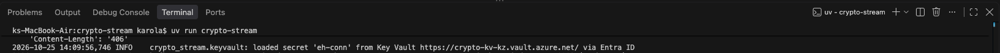
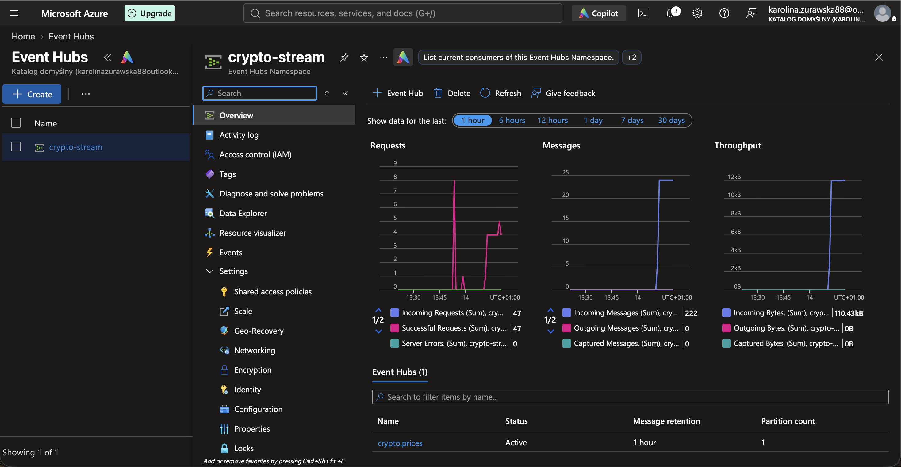
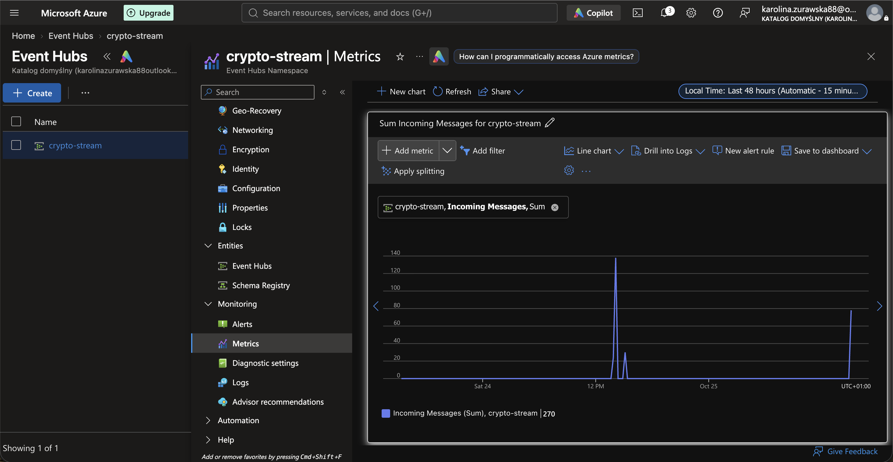
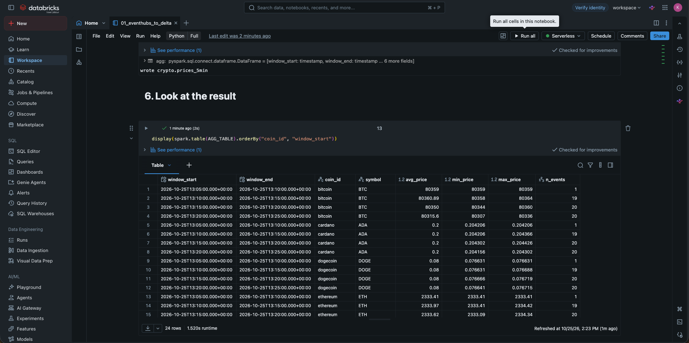
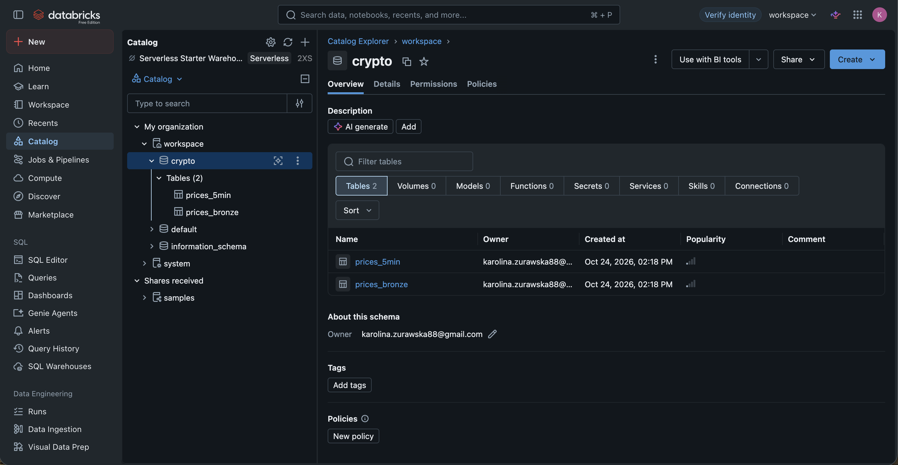

# Crypto Stream — real-time cryptocurrency data pipeline

[](https://github.com/kzurawska8/crypto-stream/actions/workflows/ci.yml)

An end-to-end **streaming data engineering** project: it ingests live crypto market
data from a public API, streams it through Kafka / Azure Event Hubs, and processes it
with Apache Spark on Databricks into a Delta Lake lakehouse - with credentials managed
in Azure Key Vault.

> Built to demonstrate a modern, cloud-native data pipeline end to end:
> **ingestion → streaming transport → distributed processing → lakehouse storage**,
> with production-style secret management.

## Architecture

```
 CoinGecko API
      │  REST, polled on an interval
      ▼
 Python producer  ──fetches secret──▶  Azure Key Vault  ◀── Microsoft Entra ID
 (crypto-stream)                                             (service principal)
      │  clean JSON records, keyed by coin
      ▼
 Kafka   /   Azure Event Hubs          Kafka protocol — local broker OR managed cloud
      │
      ▼
 Databricks  (Apache Spark — Structured Streaming / batch)
      │  parse • de-duplicate • 5-minute windowed aggregates
      ▼
 Delta Lake:  crypto.prices_bronze   +   crypto.prices_5min
```

## Demo

**Producer streaming into Azure Event Hubs (secret pulled from Key Vault):**



### Data landing in Azure Event Hubs

| Namespace overview | Incoming-message metrics |
| --- | --- |
|  |  |

### Processed into Delta tables on Databricks

| Notebook output (5-min aggregates) | Delta tables in the catalog |
| --- | --- |
|  |  |

## Tech stack & skills demonstrated

| Area | Technology |
|------|-----------|
| Language / tooling | Python 3.14, `uv` |
| Streaming transport | Apache Kafka (local), **Azure Event Hubs** (Kafka-compatible API) |
| Stream processing | **Apache Spark** (Structured Streaming) on **Databricks** |
| Storage / format | **Delta Lake** (lakehouse, medallion bronze → silver) |
| Secrets & identity | **Azure Key Vault**, **Microsoft Entra ID** service principal |
| Containerization | Docker, Docker Compose |
| Engineering practices | modular code, config-as-environment, retries/backoff, graceful shutdown, `.gitignore` secret hygiene |

## What it does

1. Polls the free CoinGecko API for price, volume, and market cap of selected coins.
2. Shapes each coin into a clean, keyed JSON record (ingestion timestamp + unique id).
3. Publishes records to a Kafka topic / Event Hub, keyed by coin.
4. Databricks reads the stream, parses it against a schema, and writes two Delta tables:
   - `crypto.prices_bronze` — every event, typed and de-duplicated
   - `crypto.prices_5min` — 5-minute avg / min / max price per coin

## Why this architecture (design decisions)

**Why a message broker (Kafka / Event Hubs) instead of writing straight to a database?**
Decoupling, buffering, and replay. The producer doesn't know or care who consumes; the
broker absorbs bursts, lets multiple independent consumers read, and allows
re-processing from history. It's the backbone of streaming systems.

**Why Azure Event Hubs rather than self-hosting Kafka in the cloud?**
Event Hubs speaks the Kafka protocol, so the producer code is unchanged — but it's fully
managed (no brokers to run, patch, or scale). A single environment variable switches
between local Kafka and the cloud.

**Why Databricks + Delta Lake (and not, say, Elasticsearch + Kibana)?**
Databricks is the **processing/compute engine** (managed Apache Spark); Delta Lake is the
**storage layer** — a *lakehouse*: cheap object storage with database-like ACID
transactions and SQL. Separating compute from storage is the heart of the modern data
stack: scale them independently, keep storage cheap, spin compute up on demand, and run
batch + streaming + SQL + ML on the *same* tables. Elastic/Kibana is excellent for search
and observability, but the Spark + Delta lakehouse is the industry-standard pattern for
**data engineering** and is what these roles hire for.

**Why Azure Key Vault + a service principal for secrets?**
Credentials never live in code or git. The connection string sits in Key Vault; the app
authenticates with an Entra ID identity and fetches it at runtime — the enterprise pattern
for secret management, and the secret is rotatable without touching the app.

## Run it

### Local (Docker) — Kafka on your machine
```bash
docker compose up -d --build        # Kafka + Kafka-UI + producer
docker compose logs -f producer     # watch it produce
# Kafka-UI: http://localhost:8080
docker compose down                 # stop everything
```

### Against Azure Event Hubs
1. Create an Event Hubs namespace (**Standard** tier) + an event hub `crypto.prices`.
2. Store the connection string in Azure Key Vault (secret `eh-conn`).
3. Copy `crypto-stream/.env.example` → `crypto-stream/.env` and fill in the values.
4. Run:
   ```bash
   cd crypto-stream
   set -a; . ./.env; set +a
   uv run crypto-stream
   ```

### Databricks (processing → Delta)
Import `databricks/01_eventhubs_to_delta.py` into your workspace, set the three config
values, and **Run All**. Details in the notebook header.

## Project structure

```
.
├── docker-compose.yml              # Kafka + Kafka-UI + producer (local stack)
├── crypto-stream/                  # the Python producer (uv project)
│   ├── src/crypto_stream/
│   │   ├── __init__.py             # poll loop + wiring
│   │   ├── config.py               # env-driven settings
│   │   ├── coingecko.py            # API client (retries / backoff)
│   │   ├── records.py              # raw API → clean record
│   │   ├── sinks.py                # stdout / Kafka / Event Hubs output
│   │   └── keyvault.py             # fetch the secret from Azure Key Vault
│   ├── Dockerfile
│   └── .env.example
└── databricks/
    └── 01_eventhubs_to_delta.py    # Spark: Event Hubs → Delta tables
```

## Possible extensions

- Real-time streaming read in Databricks (`readStream` + `trigger(availableNow=True)`)
- A BI dashboard (Databricks SQL / Power BI) over the 5-minute table
- Persist Delta in ADLS Gen2 (Azure-native storage layer)
- Unit tests + a GitHub Actions CI pipeline
- A WebSocket source for true tick-level data

---

*A learning / portfolio project exploring the modern streaming + lakehouse data stack.*
